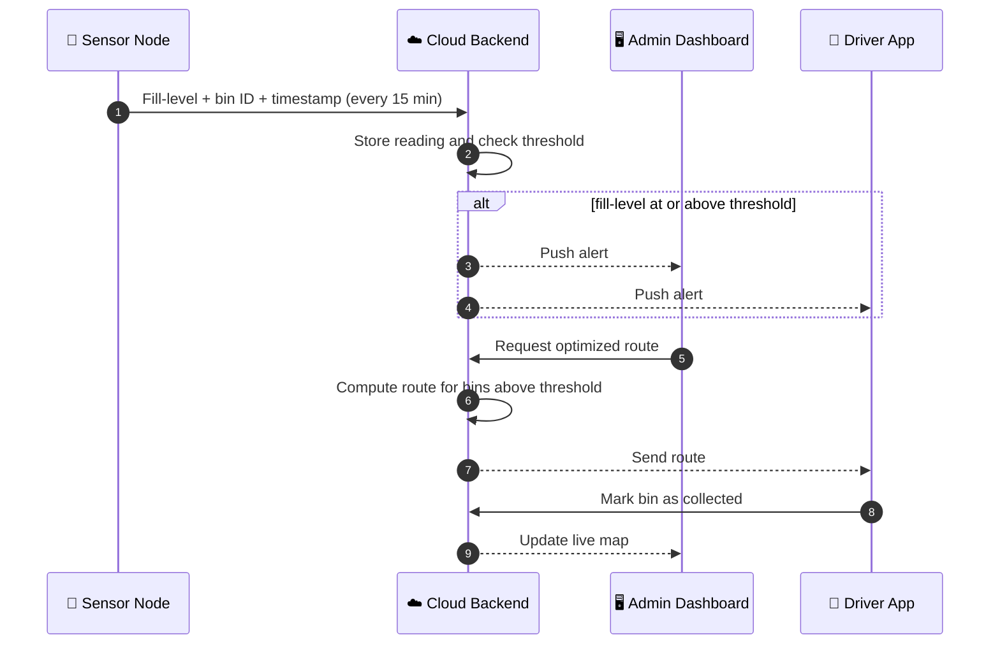
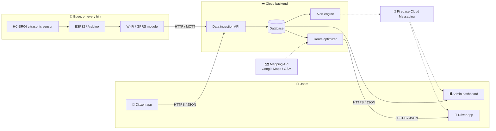
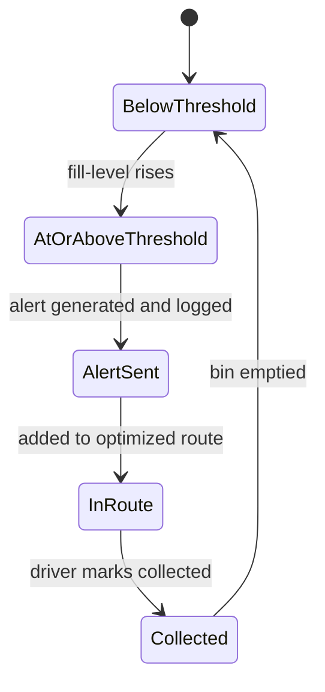
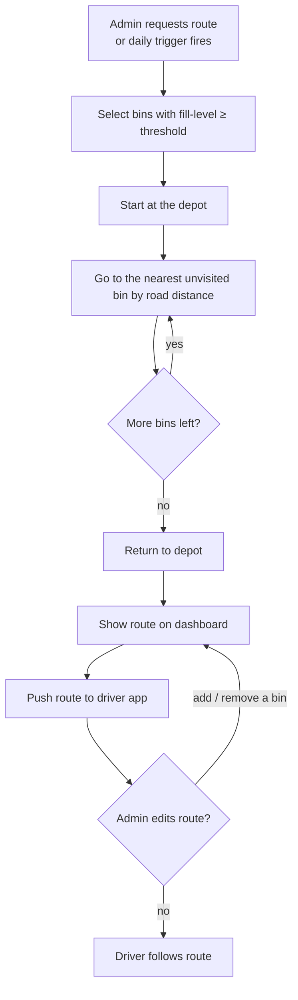
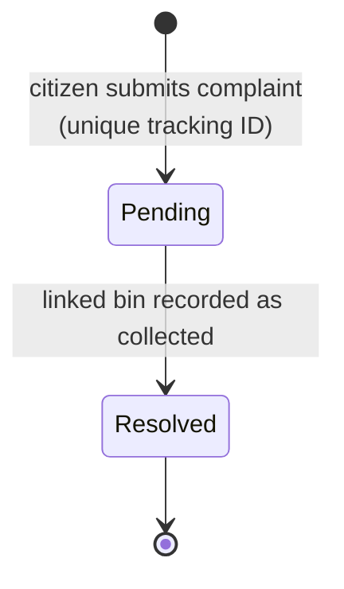

<div align="center">

# ♻️ Smart Waste Collection Management System

**Empty bins when they are full, not when the calendar says so.**

An IoT-based system that watches bin fill-levels in real time, raises alerts, plans the shortest collection route and lets citizens report overflowing bins.


</div>

---

## 📑 Table of Contents

- [Overview](#-overview)
- [Why this project](#-why-this-project)
- [How it works](#-how-it-works)
- [System architecture](#-system-architecture)
- [Features](#-features)
- [Bin status at a glance](#-bin-status-at-a-glance)
- [Route optimization](#-route-optimization)
- [Complaint lifecycle](#-complaint-lifecycle)
- [Tech stack](#-tech-stack)
- [Performance and quality targets](#-performance-and-quality-targets)
- [Roadmap](#-roadmap)
- [Open decisions](#-open-decisions-tbd)
- [Team](#-team)
- [References](#-references)

---

## 🌍 Overview

Most cities collect waste on fixed schedules. Trucks visit half-empty bins while other bins overflow between visits. This project replaces that guesswork with data.

Ultrasonic sensors on each bin measure how full it is. The readings go to a cloud backend, which alerts staff, builds an optimized route for only the bins that need pickup, and shows everything on a live dashboard. Citizens can report problems from a mobile app and track the complaint until it is resolved.

---

## 🎯 Why this project

| Today (manual) | With this system |
|---|---|
| Fixed schedules and fixed routes | Collection driven by actual fill-level |
| Bins overflow between visits | Alert before the bin is full |
| Fuel and staff time wasted on half-empty bins | Route covers only bins that need pickup |
| No real-time data or history | Live map and analytics dashboard |
| No simple way to report a problem | Citizen app with a trackable complaint ID |

---

## ⚙️ How it works



**The fill-level formula**

```
                 D_empty − D_measured
   Fill %  =  ─────────────────────────  × 100
                      D_empty
```

`D_empty` is the distance from the lid to the floor of an empty bin. `D_measured` is the current sensor reading. A bin 100 cm deep that reads 20 cm is **80% full**.

---

## 🏗️ System architecture



| Component | What it does |
|---|---|
| Sensor node | Measures fill-level and sends it to the cloud |
| Cloud backend | Stores data, checks thresholds, plans routes, serves the apps |
| Admin dashboard | Live map, analytics, threshold settings |
| Driver app | Shows the day's route, lets the driver mark bins collected |
| Citizen app | Reports overflowing bins and tracks complaints |

---

## ✨ Features

| # | Feature | Priority | What you get | Requirement IDs |
|---|---|---|---|---|
| 1 | **Bin fill-level monitoring** | High | Readings at a configurable interval (default 15 min), with retry and logging on sensor errors | `REQ-BM-1` to `REQ-BM-3` |
| 2 | **Threshold alerts** | High | Configurable threshold per bin or globally, alert within 5 minutes, full audit log | `REQ-AL-1` to `REQ-AL-3` |
| 3 | **Route optimization** | High | Route for all bins above threshold, within 10 seconds for up to 200 bins, manual add/remove | `REQ-RO-1` to `REQ-RO-3` |
| 4 | **Admin dashboard and analytics** | Medium | Colour-coded bin map, collection and average fill-level reports, admin-only login | `REQ-DB-1` to `REQ-DB-3` |
| 5 | **Citizen complaints** | Medium | Report with location and optional photo, unique tracking ID, Pending/Resolved status | `REQ-CF-1` to `REQ-CF-3` |

---

## 🚦 Bin status at a glance

The dashboard colours every bin green, yellow or red by fill-level. An illustrative view:

```
Bin A   [██████████████████░░]   90%   🔴  collect now
Bin B   [███████████████░░░░░]   75%   🟡  filling up
Bin C   [██████████░░░░░░░░░░]   50%   🟢  fine
Bin D   [███░░░░░░░░░░░░░░░░░]   15%   🟢  fine
```

The exact colour cut-offs and the default alert threshold (for example 80%) are decided after pilot testing.

### Life of a bin



---

## 🚛 Route optimization

Collection is a form of the Vehicle Routing Problem. The baseline uses the **nearest-neighbor heuristic**, with road distances from the mapping API.



A Vehicle Routing Problem solver is the alternative if the heuristic proves too weak (see [open decisions](#-open-decisions-tbd)).

---

## 📬 Complaint lifecycle



Complaints close automatically once the matching bin is marked collected.

---

## 🧰 Tech stack

| Layer | Technology |
|---|---|
| Microcontroller | ESP32 or Arduino |
| Sensor | HC-SR04 ultrasonic (or equivalent) |
| Connectivity | Wi-Fi or SIM800L GSM/GPRS, HTTP or MQTT |
| Power | Battery with solar panel, weatherproof enclosure |
| Backend | Node.js or Django, REST APIs |
| Hosting | AWS, Firebase or Render (Linux) |
| Database | MongoDB or PostgreSQL |
| Admin dashboard | Web app (Chrome, Firefox, Edge) |
| Mobile app | Flutter or React Native, Android 8.0+ and iOS 13+ |
| Maps and routing | Google Maps or OpenStreetMap |
| Notifications | Firebase Cloud Messaging |

---

## 📊 Performance and quality targets

| Area | Target |
|---|---|
| Sensor capacity | At least 500 concurrent sensor nodes |
| Dashboard load | Within 3 seconds on a normal connection |
| Route computation | Within 10 seconds for up to 200 bins |
| Alert delay | Within 5 minutes of a bin crossing the threshold |
| Data delivery | At least 95% of sensor transmissions succeed |
| Security | HTTPS/TLS everywhere, admin login with optional OTP |
| Safety | Weatherproof enclosure; a system failure never blocks manual collection |
| Maintainability | Separate modules for monitoring, alerts, routing and dashboard |

---

## 🗺️ Roadmap

- [x] Problem identification and scope (Lab 1)
- [x] System features and functional requirements (Lab 2)
- [x] Non-functional requirements and interfaces (Lab 3)
- [x] SRS final review, version 1.0
- [ ] Sensor node prototype (ESP32 + HC-SR04)
- [ ] Backend APIs and database
- [ ] Admin dashboard
- [ ] Driver and citizen mobile app
- [ ] Route optimization module
- [ ] Testing and pilot run
- [ ] Phase 2: live GPS tracking of collection vehicles

---

## ❓ Open decisions (TBD)

| ID | Decision |
|---|---|
| TBD-1 | Route algorithm: nearest-neighbor heuristic or a Vehicle Routing Problem solver |
| TBD-2 | Mapping provider: Google Maps or OpenStreetMap, based on cost |
| TBD-3 | Default alert threshold, to be fixed after pilot testing |

---

## 👥 Team

KIET Deemed to be University, Department of Computer Science Engineering, Group 6 (CSE-E)

| Name | Roll Number | Role |
|---|---|---|
| Tanishka Singh | 2400290100316 | Team Leader (Product Manager) |
| Subhonita Sarkar | 2400290100310 | Developer |
| Shubh Seth | 2400290100295 | Developer |
| Shubham Singh Rajput | 2400290100301 | Tester |

---

## 📚 References

- IEEE Software Requirements Specification template (Karl E. Wiegers)
- IEEE Std 830-1998, Recommended Practice for Software Requirements Specifications
- Software Requirements Specification for Smart Waste Collection Management System, Version 1.0

---

<div align="center">

Made for a cleaner city. 🌱

</div>
